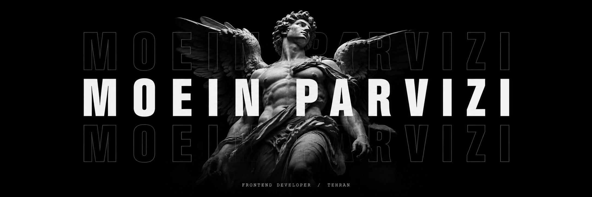

<div align="center">

```math
\mathrm{Interface} = f(\mathrm{state})
```



</div>

```js
const response = {
  status: 200,
  data: {
    fullName: "Moein Parvizi",
    role: "Frontend Developer",
    basedIn: "Tehran, Iran",
    focus: ["web interfaces", "responsive design", "user experience"],
    frontend: ["TypeScript", "JavaScript", "React", "Next.js", "Angular"],
    backendExperience: ["Python", "Django", "REST APIs", "SQL"],
    tools: ["Git", "Linux", "Neovim", "Figma"],
    website: "https://moeinparvizi.vercel.app",
    currently: "Building a multilingual portfolio with an admin dashboard",
  },
};
```

[](https://moeinparvizi.vercel.app)
[](https://www.linkedin.com/in/moeinparvizi2002/)
[](https://stackoverflow.com/users/15075609/moein-parvizi)
[](https://github.com/moeinparvizi?tab=repositories)

**Selected work** &nbsp; [Portfolio](https://github.com/moeinparvizi/portfolio) · [Music Player](https://github.com/moeinparvizi/music-player) · [Neovim](https://github.com/moeinparvizi/neovim)
