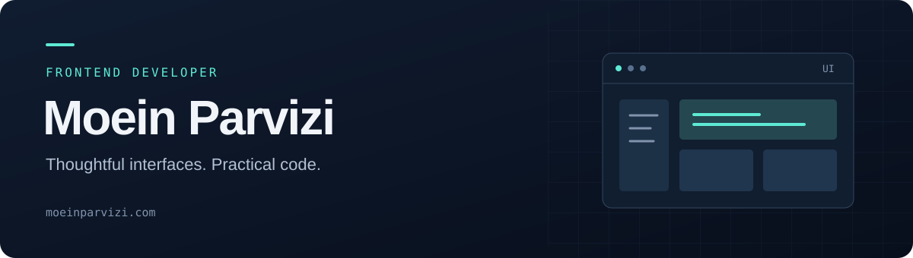

<p align="center">
  
</p>

<p align="center">
  <a href="https://moeinparvizi.vercel.app">Website</a> &nbsp;·&nbsp;
  <a href="https://www.linkedin.com/in/moeinparvizi2002/">LinkedIn</a> &nbsp;·&nbsp;
  <a href="https://stackoverflow.com/users/15075609/moein-parvizi">Stack Overflow</a>
</p>

## Hi, I'm Moein

I'm a frontend developer based in Tehran, Iran. I focus on building web interfaces, with backend experience that helps me connect the UI to the rest of an application.

My projects range from React and Next.js applications to an Angular portfolio. Outside the browser, I enjoy working with Linux and shaping my development environment with Neovim.

```js
const moein = {
  name: "Moein Parvizi",
  role: "Frontend Developer",
  basedIn: "Tehran, Iran",
  languages: ["TypeScript", "JavaScript", "Python"],
  frontend: ["React", "Next.js", "Angular", "Tailwind CSS"],
  alsoWorkWith: ["Django", "REST APIs", "SQL"],
  environment: ["Linux", "Neovim", "Git"],
};
```

## Toolkit

| Area | Technologies |
| :--- | :--- |
| Languages & foundations | TypeScript · JavaScript · HTML · CSS |
| Frontend | React · Next.js · Angular · Tailwind CSS · Sass |
| Backend experience | Python · Django · Django REST Framework · MySQL · SQLite |
| Tools | Git · Linux · Neovim · Figma · Postman |

## Selected projects

### [Portfolio](https://github.com/moeinparvizi/portfolio)

A personal website with an Angular frontend and NestJS backend. Includes a galaxy-inspired design, light and dark themes, English/Farsi/German support, and an admin dashboard.

`Angular` `TypeScript` `NestJS` `PostgreSQL`

### [Music Player](https://github.com/moeinparvizi/music-player)

A responsive music interface built with React and Next.js, featuring API integration and animations with Framer Motion.

`React` `Next.js` `JavaScript` `Framer Motion`

### [Neovim](https://github.com/moeinparvizi/neovim)

My personal Neovim configuration, written in Lua.

`Lua` `Neovim`

---

Interested in my work? Explore the projects above or get in touch through [LinkedIn](https://www.linkedin.com/in/moeinparvizi2002/).
